# Aisling - Wellkeeper

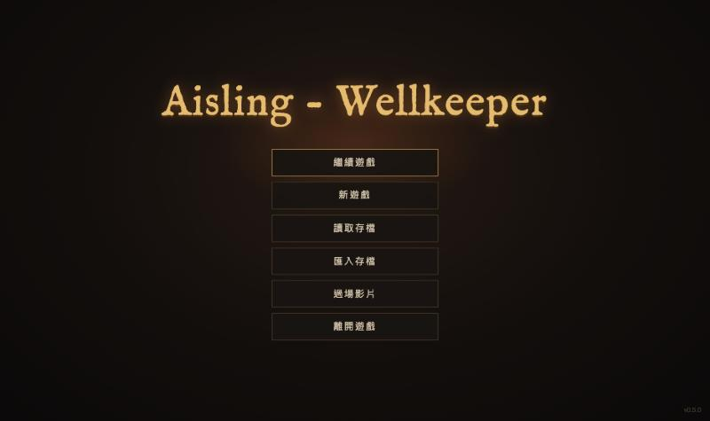

一款 Diablo 風格的等角動作 RPG，直接在瀏覽器裡玩，不用安裝。

> 村子底下有一口井。一千年來，守門人一個接一個下去封住它，沒有人回來過。如今死者從地窖裡爬出來，騎士團又派了一個人下去。

**▶ 線上遊玩：https://kochinchen.github.io/ARPG_GAME/**

📘 設計文件（怪物、裝備、成長模擬、組合技、開發歷程、故事與世界觀、小說；含劇透）：https://kochinchen.github.io/ARPG_GAME/design/

📖 小說《井誌》（約 9.5 萬字、44 章，中英文切換，收錄遊戲裡全部 69 頁與過場；含劇透）：https://kochinchen.github.io/ARPG_GAME/design/novel.html

<table>
<tr>
<td width="72%">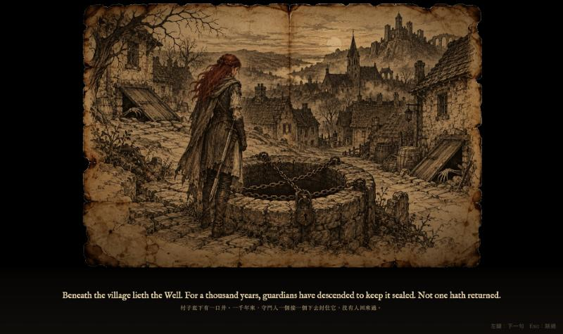<br><sub>進入新的一環前的過場影片：舊紙畫、英文旁白與字幕。</sub></td>
<td width="28%" valign="top">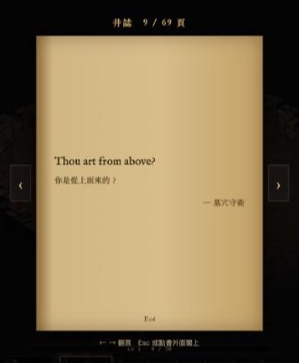<br><sub>《井誌》：收集到的內容合成一本小書。</sub></td>
</tr>
</table>

## 遊戲內容

- **一路往下，就是倒著走過這片土地的歷史**：每一環的入口站著一位墮落的守門人。進入新的一環前，有一段舊紙畫與英文旁白的過場影片；看過的影片可以在標題畫面重看。
- **《井誌》（按 Y）**：地圖上散落的遺物、夾在寶箱裡的筆記、魔王倒下時飄出的魂魄，都會收進這本 69 頁的小書。沒找到的頁只會顯示「？？？」，湊齊才讀得到完整的故事。打完最終魔王後不妨往回走一趟，井裡還留著一頁不在目錄裡的東西。
- **35 層地牢**：地圖由種子隨機產生，主路旁會出現小說裡的固定場景（死人的晚餐、粉筆牆、隊長與師父的房間、手牆）；每 5 層一位樓層魔王，第 30 層通關。之後是 31～35 層的極限挑戰，最後在王座廳對上隱藏的最終魔王。
- **近戰、遠程、魔法、戰術、輔助五條技能樹**：每類 12 招、4 階，學會 T4 後達成 Mastery。戰術技能（身法、機關、投擲）任何武器都能用。
- **七組三段連段（Q / W / E / R / A / S / D，依等級解鎖）**：三個技能依序施放，符合規則就組成組合技，共 24 條規則（含 2 條秘密組合技），見下方〈組合技〉。
- **武器決定能用的技能**：劍 / 斧可用近戰、魔法、戰術；弓可用遠程、魔法、戰術；法杖可用魔法、戰術。盾擊另外需要盾牌。
- **六種稀有度裝備**：白、藍、黃、紫、橘（傳奇 132 件）、紅（神話 66 件）。橘、紅裝備有專屬效果，例如分裂箭、小火球、疊層增益，以及只在組合技成立時觸發的特殊效果。
- **怪物**：30 多種一般怪物、5 種精英詞綴、7 位多階段魔王與 3 隻隱藏魔王（見最下面）；怪物的招式看到出招跑開就躲得掉（只有普通攻擊例外），魔王還有和實際範圍一樣大的地面預警；近戰會包圍主角，10 層起還會學走主角的技能；越深的樓層，怪物的生命、攻擊與技能範圍越強。第 5 層起還有機率遇到火、冰、雷、毒四種結晶獸，打倒會噴出金幣。
- **裝備成長**：喜歡的裝備可以**飛昇**到更高階、**重鑄**詞綴、**鑿孔鑲嵌**熔核（在背包自己鑲、自己取下）；用不到的裝備可以**融合**成熔核或拆成精華。連白裝都能用同一種熔核鑲滿，打造成自己的主力武器。詳見下方〈裝備成長：飛昇、鑲嵌、融合〉。
- **其他**：商人、賭博；3 個存檔欄位，會自動存檔，也能匯出 / 匯入；商人旁邊的**共用倉庫**（5 頁、共 150 格）讓不同存檔交換裝備與熔核。

## 組合技

把三個技能放進同一格連段（技能頁 T），按右鍵就會依序施放。遊戲依每招的**標籤**判定能不能組成組合技：距離（近 / 中 / 遠）、動作（重擊、快速、多段、投射物…）、元素（火 / 冰 / 雷）、控制（緩速、冰凍、暈眩、浮空…）與定位（起手、鋪墊、終結）。規則不綁定技能名稱，所以同一條規則有很多種排法。

成立時，第三招（部分規則連第二招）會得到加成，例如：

| 連段 | 組合技 | 效果（Lv1） |
| --- | --- | --- |
| 重砍 → 重砍 → 火球 | 烈焰終擊（秘密） | 火球變成巨型火球：傷害 +40%、範圍 +50%、大小 +30% |
| 火球 → 火焰爆破 → 火牆 | 煉獄 | 火牆傷害 +25%、範圍 +20%、燃燒 +25% |
| 冰球 → 電擊 → 淬毒飛刀 | 雙元素附刃 | 飛刀追加冰霜傷害 +20%、雷電傷害 +20% |
| 火球 → 火球 → 淬毒飛刀 | 元素投擲 | 飛刀傷害 +15%、追加火焰傷害 +30% |
| 冰球 → 火藥桶 → 火球 | 元素陷阱 | 火藥桶傷害 +20%、追加冰霜傷害 +25%；火球傷害 +15% |
| 挑空斬 → 快斬 → 處決斬 | 浮空追擊 | 處決斬傷害 +25%、暴擊率 +15% |
| 盾擊 → 重砍 → 重砍 | 破綻一擊 | 第三招傷害 +25%、暴擊率 +15% |

煉獄、雙元素附刃、元素投擲、元素陷阱任何武器都能用，法杖玩家也能打出組合技；技能等級越高，加成越大（Lv5 為 Lv1 的 1.4 倍）。

幾個基本規則：

- 一定要三招，同一招連放三次不算；距離不能「近 → 遠 → 近」或「遠 → 近 → 遠」來回跳。
- 三招都得是手上武器能用的技能，否則整組不施放。所以近戰和遠程技能不會在同一組，法杖玩家用「魔法＋戰術」組合。
- 第一次打出的組合技會記進組合技圖鑑；有些傳奇 / 神話裝備只在組合技成立時觸發（例如世界裂痕）。

目前 24 條規則在 48 個主動技能、110,592 種排列中，有 25,186 種會成立，其中 19,646 種有武器能用（劍 / 斧 11,610、弓 11,170、法杖 3,134）。完整規則、每一種排列與連段試算在[組合技圖鑑](https://kochinchen.github.io/ARPG_GAME/design/combos.html)。還有很多組合沒人試過，歡迎找出你自己的流派。

## 裝備成長：飛昇、鑲嵌、融合

好裝備不會因為樓層變深就被淘汰，用不到的裝備也不只能賣掉。拆解和鑲嵌在背包隨時可做，其他在商人那裡完成（每層的樓梯口、中途存檔點、出口旁各有一位）：

| 功能 | 在哪裡 | 做什麼 | 需要 |
| --- | --- | --- | --- |
| **拆解** | 背包的拆解區 | 把裝備或熔核拆成精華（武器 → 武器精華、防具與飾品 → 防具精華） | — |
| **飛昇** | 商人「鍛造」分頁 | 基底升到同種類的下一階（最高第 8 階），名稱、詞綴、主倍率、傳奇效果、孔與熔核全部保留 | 金幣、精華；第 5 階起要飛昇碎片（魔王掉落） |
| **重鑄** | 商人「鍛造」分頁 | 重抽一條詞綴（橘 / 紅裝重擲固定屬性的數值） | 金幣；每重鑄一次再貴 50% |
| **鑿孔、鑲嵌** | 鑿孔：商人「鍛造」分頁；鑲嵌：背包 | 在武器、盾牌、頭盔、盔甲、手套、鞋子上鑿孔；拿著熔核點有空孔的裝備就鑲進去，右鍵裝備把熔核一顆一顆取回背包（孔保留）；角色等級要達到熔核的物品等級才能鑲 | 鑿孔：金幣、防具精華；鑲嵌 / 取下免費 |
| **融合** | 商人「融合」分頁 | 把 2～4 件用不到的裝備（飾品以外）熔成一顆熔核 | 金幣、精華 |

### 融合：把用不到的裝備熔成熔核

<table>
<tr>
<td width="68%">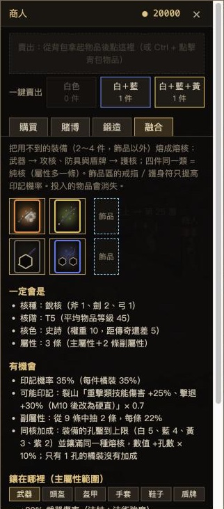</td>
<td width="32%" valign="top">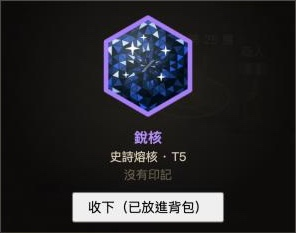<br><sub>按下融合，寶石揭曉。</sub></td>
</tr>
</table>
<sub>四把武器放進融合格：核種、核階、核色、印記機率、各部位的屬性範圍與費用，按下融合前都看得到。</sub>


- 武器熔成攻核：劍 → 銳核、斧 → 重核、弓 → 穿核、法杖 → 靈核。
- 防具熔成護核：盔甲與盾牌 → 壁核、鞋子 → 疾核、手套 → 掌核、頭盔 → 冠核。
- 核種看多數決，平手變成混核；四件同一類是純核，屬性多一條。
- 核階看平均物品等級（每 8 級一階，32 以上是最高的 T5），核色看投入裝備的稀有度。這些按下融合前就看得到，只有數值、副屬性與印記是骰子；融合後有寶石揭曉動畫。
- 投入橘色裝備，有機會把它的強屬性（◆）變成「印記」傳進熔核；飾品區放戒指或護身符可以提高機率。

### 鑲嵌：讓熔核成為裝備的一部分

<table>
<tr>
<td width="60%" valign="top">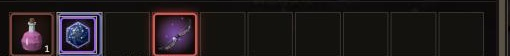<br><sub>拿著熔核點有空孔的裝備就鑲進去，身上或背包裡的裝備都可以，不用找商人。</sub></td>
<td width="40%" valign="top">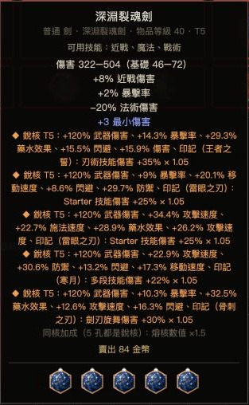<br><sub>白色的劍鑲滿兩顆銳核：武器傷害 +154%、同核加成 ×1.2。</sub></td>
</tr>
</table>


- **自己鑲、自己取下**：在背包拿著熔核點有空孔的裝備就鑲進去；右鍵裝備取下最後鑲入的熔核、放回背包（背包滿了才拿在手上），連按右鍵就能一顆一顆取下。鑲嵌和取下都免費，只有鑿孔要到商人「鍛造」分頁。
- **同一顆熔核鑲在不同部位效果不同**：例如銳核在武器上加暴擊率，在鞋子上加移動速度。滑鼠移到熔核上，可以看到它鑲在武器、頭盔、盔甲、手套、鞋子、盾牌各加什麼。
- **鑲在武器加武器傷害**：依核階 T1 +16%、T2 +32%、T3 +48%、T4 +64%、T5 +80%，每顆各算一次，和裝備的主倍率相加（法杖加法術強度）。
- **熔核不看裝備稀有度**：孔數和稀有度相反（白 5、藍 4、黃 3、紫 2、橘 1、紅 0；白 / 藍 / 黃掉落時可能已經帶孔），所以孔最多的白裝也能打造成符合自己需求的強裝。
- **同核加成**：一件裝備的孔都鑲滿同一種熔核（核階可以不同），那件裝備上的熔核數值 +孔數 × 10%（白裝 5 孔 ×1.5、紫裝 2 孔 ×1.2）。白裝 5 顆 T5 同核的武器傷害是 80% × 5 × 1.5 = +600%。
- **全身上限**：同一種屬性全身合計有上限（一顆 T5 橘核最高值的 1.5 倍），不能無限疊；同核鑲滿的裝備會放寬它提供的屬性的上限，每件多「孔數 × 0.5 顆」。武器傷害不受上限。
- 盾牌也能鑲嵌（只有劍、斧能配盾）：盾牌上的熔核偏防禦與控制抗性，例如壁核加格擋率、靈核加元素抗性；重核加盾擊傷害。
- 鑲好的熔核會出現在裝備格角落與說明框，熔核核階也會讓角色腳下的光芒更亮。

### 飛昇：讓喜歡的裝備跟上樓層

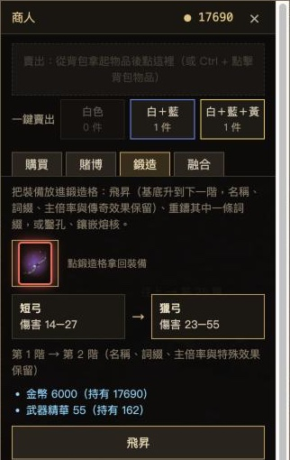

<sub>傳奇斧「裂山」飛昇：鐵製戰斧（傷害 19–56）→ 月刃斧（傷害 33–82），傳奇屬性原封不動。</sub>


- 裝備的基底階級在掉落時就固定了，越往下打越顯得弱。飛昇把基底換成同種類的下一階，攻擊力或防禦跟著提高，其他內容都不變（飾品沒有階級，不能飛昇）。
- 越高階、越稀有越貴；第 5 階起另外需要魔王掉落的飛昇碎片（第 5 階 1 片 … 第 8 階 4 片）。
- 鑲好熔核的裝備一樣能飛昇，孔與熔核保留，所以一件好裝備可以一路用到最深層。

規則、數值表與融合範例在[裝備圖鑑的熔核頁](https://kochinchen.github.io/ARPG_GAME/design/items.html#cores)（飛昇費用表在同一份圖鑑的最後一節）；[角色成長模擬](https://kochinchen.github.io/ARPG_GAME/design/growth.html#fusion)可以試算融合結果。

## 操作

| 按鍵 | 功能 |
| --- | --- |
| 左鍵 | 移動 / 攻擊（按住 Shift 原地攻擊） |
| 右鍵 | 施放目前選中的連段（背包裡右鍵裝備：取下熔核） |
| Q / W / E / R / A / S / D | 切換連段（W Lv3、E Lv6、R Lv10、A Lv15、S Lv20、D Lv25 解鎖） |
| Space | 喝藥水 |
| I / C / T | 背包 / 角色 / 技能 |
| K / O | 怪物圖鑑 / 裝備圖鑑 |
| Y | 井誌（← → 翻頁） |
| Tab | 地圖 |
| Esc | 選單（遊戲內有完整操作說明）；過場影片中按 Esc 跳過、左鍵下一句 |

iPad 等觸控裝置會自動顯示左側搖桿，以及右側的攻擊、招式、Q / W / E / R、藥水按鈕，攻擊時會自動瞄準最近的敵人。

建議使用 Chrome 或 Edge。存檔存在這台裝置的這個瀏覽器裡，換裝置前請先在選單「匯出存檔」。

## 開發

需要 Node.js。

```bash
npm install
npm run dev        # 開發伺服器 http://localhost:5173
npm test           # 單元測試
npm run lint       # 型別檢查 + 依賴方向檢查
npm run package    # 可攜版遊戲包（單一 HTML + Windows / Mac 啟動檔）
npm run docs:cores # 重新產生裝備圖鑑的熔核頁
npm run docs:pages # 把設計文件複製到 docs/design/
npm run balance    # 自動難度測試
npm run package:sim # 魔王模擬器與敵方範圍圖的單一 HTML（開發頁：/boss-sim.html、/area-chart.html）
node scripts/render-story-doc.mjs    # 重新產生「故事與世界觀」設計文件
node scripts/render-novel-doc.mjs    # 重新產生小說《井誌》（文稿在 scripts/novel/）
python3 scripts/prelude_audio.py f1  # 重新產生過場影片的旁白（需要 macOS）
```

技術：TypeScript、Vite、Three.js 與 PixiJS 8（遊戲畫面；預設用 Three.js 畫地板、角色和牆，瀏覽器不支援 WebGL2 時改用 Pixi）、Vue 3（介面）、Zod（資料驗證）、Vitest。

- 遊戲邏輯在 `src/game/`，以固定 60 Hz 更新，所有隨機都使用固定種子，而且不依賴畫面。
- 怪物、技能、物品、詞綴、樓層、過場影片與故事文字等內容都寫在 `src/data/`；新增內容通常只需要改資料。
- 架構與規則見 [docs/ARCHITECTURE.md](docs/ARCHITECTURE.md)、[CLAUDE.md](CLAUDE.md)；存檔、組合技、終局規格在 `docs/` 裡。

### GitHub Pages

`docs/` 資料夾就是線上版：

- `docs/index.html`：遊戲本身（`npm run package` 之後複製 `release/ARPG-遊戲包/ARPG.html`）
- `docs/design/`：設計文件與小說（`npm run docs:pages`）

## 隱藏魔王

### 奪界雙手

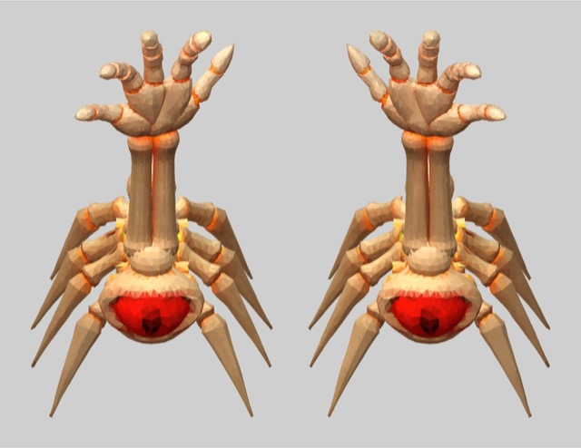

一對爬行的骷髏手臂，一左一右：橫躺的上手臂是身體，由蜘蛛般的腳撐著，手肘的關節是一顆血紅的眼睛，垂直的下手臂頂端是手掌。牠們共用一個名字，兩隻都倒下才算打贏；會隔著你雙掌合擊，也會伸手奪走你的技能。

### 萬骸之口

<table>
<tr>
<td>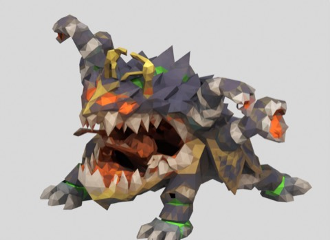<br>火焰 ＋ 毒素</td>
<td>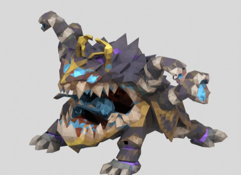<br>冰寒 ＋ 閃電</td>
<td>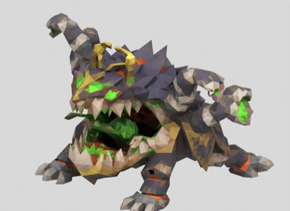<br>毒素 ＋ 火焰</td>
</tr>
</table>

地牢裡死去的士兵與騎士的怨念，把骨頭和盔甲拼成了一張巨口，四根觸手的尖端也都是嘴。牠帶著兩種屬性（火、冰、雷、毒）：第一種是眼睛與嘴裡的顏色，第二種是背脊與關節縫的顏色，共 12 種配置，看顏色就知道牠會用哪兩種屬性。

### 噬界足眼

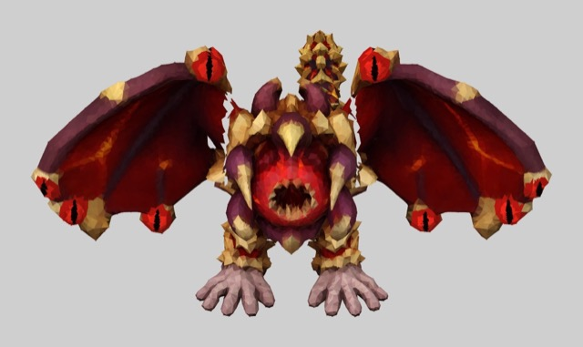

超大的血紅眼球，瞳孔是一張圓形的深口，周圍一圈會收合的巨爪；粗腿的腳掌是人手，翅膀尖端都是眼睛。爪子收合時很難傷到牠，第三階段尾巴會脫離，尖端是一張女性的臉，自己爬過來追你。
